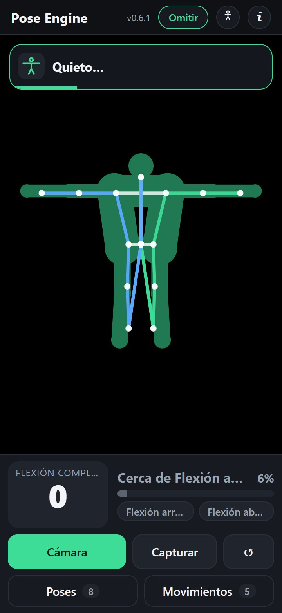

# 🤸 pose-engine

**Real-time pose detection and rep counter for the browser: MediaPipe pose tracking that runs on-device, for fitness apps and interactive demos.**

> Sigue la silueta de la pose T para calibrar, imita el fantasma de cada pose, mira tu esqueleto en vivo y cuenta repeticiones con contador grande y barra de recorrido.

**[▶ Probar la demo](https://juliangdeveloper.github.io/pose-engine/)**



## Cómo se usa

- Calibra con la silueta de la pose T: cada segmento se pone verde cuando lo cubres y la medición arranca sola al coincidir.
- Imita la pose siguiente con el fantasma: las articulaciones que no coinciden se marcan en rojo y tu esqueleto en vivo atenúa las de baja confianza.
- Toca el icono de detalle en el visor para encender el modo detallado: arcos con los grados en cada articulación, esqueleto más grueso en los segmentos rápidos, puntos de profundidad cuando un brazo apunta a la cámara y articulaciones en verde o rojo con porcentaje de coincidencia.
- Ajusta distancia y luz con los avisos «Aléjate un paso», «Acércate», «Entra en el cuadro», «Poca luz» y «Contraluz» antes de empezar.
- Captura tus poses con la cámara: haz la pose T y, tras la cuenta de 3 segundos, se guarda la pose en la que estés.
- Arma movimientos con secuencias de tus poses capturadas, por ejemplo Flexión arriba → Flexión abajo.
- Restablece las poses y movimientos de fábrica con «Restablecer poses y movimientos» en Poses o Movimientos: se pierden las propias.
- Cuenta repeticiones con contador grande, barra de recorrido y destello en el borde: verde al contar, rojo si quedó a medias.

## Usar el motor en otro proyecto

El motor es un módulo ES que se importa desde su ruta pública:

```js
const root = 'https://juliangdeveloper.github.io/pose-engine/engine/v2/';
const v = (await (await fetch(root + 'version.txt')).text()).trim();
const { createPoseEngine } = await import(root + 'index.js?v=' + v);
const engine = createPoseEngine({ video, poses, movements });
engine.on('pose', (p) => console.log(p.name, p.proximity));
engine.on('rep', (r) => console.log(r.name, r.count, r.grade.label));
engine.on('frame', (f) => console.log(f.motion.segments.leftForearm.angVel));
await engine.start({ source: 'camera' });
```

La detección usa solo poses y secuencias ordenadas de poses: ángulos articulares y posiciones relativas al torso, invariantes a la escala y a la posición en el cuadro. La velocidad y la aceleración se calculan en cada fotograma y quedan expuestas en `frame.motion` como datos para visualización y juegos, pero nunca deciden si una pose o un movimiento se detecta. El modo detallado del visor (arcos de ángulo, grosor por velocidad, profundidad y coincidencia) se dibuja con los helpers de `engine/v2/overlay.js`, exportados desde `index.js`, para reutilizarlos en otros proyectos.

## Stack

JavaScript vanilla, PWA, MediaPipe PoseLandmarker lite, sin dependencias de npm.

## Licencia

MIT

---

Más proyectos: https://juliangdeveloper.github.io/

Hecho con ❤️ y 🤸
