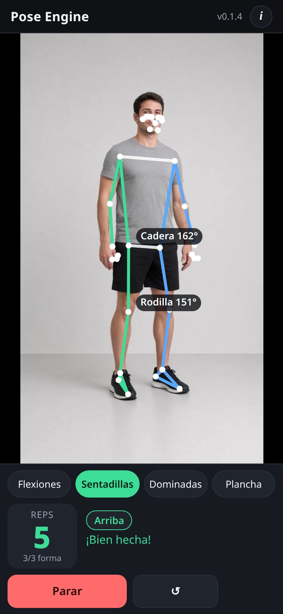

# 🤸 pose-engine

> Motor open source de estimación de pose en tiempo real para la web: lee tu cuerpo con la cámara, mide ángulos, cuenta repeticiones y cronometra posturas, todo en el dispositivo.

**[▶ Abrir la app](https://juliangdeveloper.github.io/pose-engine/)**



## Usar el motor en tu proyecto
El motor es un módulo ES en `engine/v1/`, separado de la app. Los cambios compatibles se publican ahí; uno incompatible irá a `engine/v2/`.

```javascript
const root = 'https://juliangdeveloper.github.io/pose-engine/engine/v1/';
const version = (await (await fetch(root + 'version.txt', { cache: 'no-store' })).text()).trim();
const { createPoseEngine } = await import(root + 'index.js?v=' + version);

const engine = createPoseEngine({ video: document.querySelector('video'), exercise: 'squat' });
engine.on('rep', (r) => console.log(r.count, r.quality, r.failed));
engine.on('frame', (f) => draw(f.landmarks, f.measures));
await engine.start({ source: 'camera', facingMode: 'user' });
```

- `start({ source })`: `'camera'` abre la cámara, `'video'` usa un `<video>` que ya reproduce, `'synthetic'` mueve un esqueleto generado sin cámara ni modelo. `stop()`, `reset()`, `destroy()`.
- `switchCamera()` alterna entre frontal (`user`) y trasera (`environment`). Si la cámara está abierta, detiene todas las pistas del stream anterior y espera a soltarlas antes de volver a llamar a `getUserMedia`: primero `facingMode: { exact }`, si falla `{ ideal }`, y si ninguna coincide elige un `deviceId` con `enumerateDevices`. No reinicia las repeticiones ni el cronómetro. Sin cámara abierta solo recuerda la elección para el próximo `start`. La lente elegida se conserva.
- `setLens('wide' | 'normal')` pide la vista más amplia o la de 1×. `getState()` incluye `lens`, `zoom` (el valor del track, o `null`) y `capabilities`: `zoom` con `min`, `max` y `step`, `ultraWide` y `canWiden`.
- Con `wide`, el motor pone el zoom en el mínimo de `getCapabilities().zoom` mediante `applyConstraints({ advanced: [{ zoom }] })`. En la trasera, si ese mínimo no es menor que 1, abre el `deviceId` cuya etiqueta contiene ultra, ultra gran angular o ultra-wide. En la frontal aplica el zoom mínimo si existe.
- La captura pide proporción 4:3 (3:4 en vertical) y `resizeMode: 'none'`, no un recorte 16:9. El video y el canvas usan `object-fit: contain` con el mismo encaje, así que no se recorta lo que ve la cámara.
- Eventos con `on(tipo, fn)`, que devuelve la función para quitarlo:
  - `frame`: 33 puntos normalizados y suavizados, puntos 3D en metros, medidas, fase, reps, plancha, aviso y fps.
  - `rep`: número, duración, calidad de 0 a 1 y controles de forma que fallaron.
  - `state`: cambio de fase (`lost`, `idle`, `holding` o las fases del ejercicio).
  - `hold`: segundos y mejor marca en ejercicios de aguantar.
  - `cue`: aviso de forma en vivo.
  - `status`, `ready` (con el delegado GPU o CPU) y `error` (`camera-denied`, `camera-not-found`, `model-failed`…).
- `loadExercises(defs | url)` agrega ejercicios desde un arreglo o un JSON; `setExercise(id)` cambia el activo y `exercises()` los lista.
- `feed({ landmarks, worldLandmarks }, t, ancho, alto)` procesa puntos de otro detector; también puedes pasar `detector` propio con `init()` y `detect(video, t)`.
- Opciones: `lens` (`'wide'` o `'normal'`), `smoothing` (One Euro: `minCutoff`, `beta`, `dCutoff`, o `false`), `detectorOptions` (`model: 'lite' | 'full'`, `delegate`, `modelUrl`, `wasmBase`, `tasksVisionUrl` para servirlo tú), `messages` y `minVisibility`.

## Ejercicios como datos
Cada ejercicio es un objeto JSON; el motor no sabe de flexiones ni de ballet.

```javascript
engine.loadExercises([{
  id: 'passe', name: 'Passé', kind: 'hold',
  requires: ['hip', 'knee', 'ankle'],
  optional: ['shoulder'],
  measures: { knee: { type: 'angle', points: ['hip', 'knee', 'ankle'], label: 'Rodilla' } },
  hold: { when: { knee: { lt: 60 } } },
  cues: [{ id: 'alto', text: 'Sube más la rodilla', when: { knee: { gt: 75 } } }],
}]);
```

- `requires` son las articulaciones mínimas para contar. Puede ser una lista (todas, en al menos un lado) o `{ any: [[...], [...]] }` si vale un grupo u otro. `optional` son articulaciones solo para la forma: si no se ven, el aviso y el control se omiten y la cuenta sigue.
- `measures`: `angle` se calcula con los `worldLandmarks` en metros, así que no depende de si el teléfono está de frente, de lado, arriba, abajo o en diagonal. Si faltan los puntos 3D, usa el ángulo 2D. Los dos lados se combinan pesados por visibilidad. `fallback` sustituye la medida cuando sus puntos no se ven (la sentadilla usa cadera y rodilla si no hay tobillo). `incline`, `offset` y `lineOffset` usan el mismo criterio. `side` acepta `left`, `right`, `best` o `mean`.
- Los umbrales de fase tienen histéresis: una vez dentro, hace falta cruzar unos grados de más para salir. El suavizado sigue siendo One Euro.
- Ejercicios de repeticiones (`kind: 'reps'`): `phases` con su condición y `rep` con la secuencia que cuenta una repetición, por ejemplo `['top', 'bottom', 'top']`.
- Ejercicios de aguantar (`kind: 'hold'`): `hold.when`.
- `gate` es una condición extra para empezar a contar; `cues` son avisos en vivo; `checks` revisan el mínimo o máximo de cada repetición solo si esa medida se vio.
- Las condiciones admiten `lt`, `gt`, `between`, `all`, `any` y `not`.
- `demo` define el movimiento del esqueleto sintético de `source: 'synthetic'`.

Incluidos en `engine/v1/exercises/calisthenics.js`. Cuentan con el teléfono en cualquier posición:
- Flexiones y dominadas: hombro, codo y muñeca de un lado. Cadera, rodilla y tobillo son opcionales.
- Sentadillas: cadera, rodilla y tobillo, o cadera y rodilla con el tronco si el tobillo no se ve.
- Plancha: hombro, cadera y rodilla, o hombro, cadera y tobillo.

## La app
- Elige el ejercicio y pulsa **Cámara**. El icono de cambiar cámara alterna entre frontal y trasera, también antes de encenderla. La elección se guarda en `localStorage` (`pose-engine.camera`). Si hay menos de dos cámaras de vídeo, el icono se oculta. Solo la frontal se espeja.
- **0.5× / 1×** amplía el encuadre cuando se puede (zoom mínimo o ultra gran angular). Solo aparece en ese caso. La elección queda en `pose-engine.lens` y se conserva al cambiar de cámara.
- Ves el esqueleto con los ángulos, el contador o el cronómetro, la fase y el aviso de forma.
- Si no das permiso de cámara, la página lo explica.
- ↺ reinicia el contador.

## Stack
- JavaScript vanilla, PWA con service worker, sin dependencias de npm.
- Modelo: [MediaPipe Tasks Vision](https://ai.google.dev/edge/mediapipe/solutions/vision/pose_landmarker) PoseLandmarker lite (Apache 2.0), versión 1.2.0 fijada desde jsDelivr, en modo VIDEO con GPU y respaldo en CPU.
- Por qué MediaPipe y no MoveNet con TF.js:
  - Da 33 puntos con visibilidad y además puntos 3D en metros, que hacen que los ángulos dependan menos de la vista.
  - Es un solo paquete WASM que corre en Safari de iOS con WebGL2 y cae a CPU si la GPU falla.
  - MoveNet da 17 puntos solo en 2D y necesita cargar TF.js y su backend aparte.
- El modelo y el WASM quedan en caché después de la primera carga. Los puntos se suavizan con un filtro One Euro.
- Al abrirse guarda el progreso en `localStorage` (`meta.v1.pose-engine`), que lee el [portafolio](https://juliangdeveloper.github.io/).

```
python3 -m http.server 8000
```

## Estado y límites
- En construcción.
- Probado con emulación de iPhone 13 mini y iPad mini en Chromium, con un video de sentadillas como cámara falsa. Falta probar en Safari de un iPhone real.
- Los umbrales salen de pruebas con video y esqueletos sintéticos; faltan calibrarlos con personas reales.
- La cuenta usa ángulos 3D y no pide una vista de lado. El zoom ultra gran angular no se ha probado con una cámara trasera real.

## Contribuir
Abre un issue o un PR, sobre todo en:
- Calibrar umbrales con videos reales.
- Ejercicios nuevos (artes marciales, ballet, movilidad) como datos.

Licencia: [MIT](LICENSE).

---

Más proyectos: https://juliangdeveloper.github.io/

Hecho con ❤️ y 🤸
